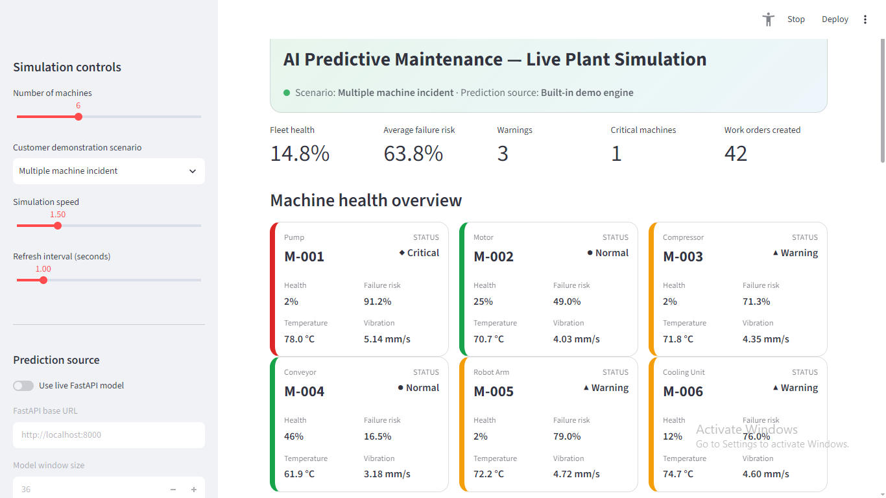
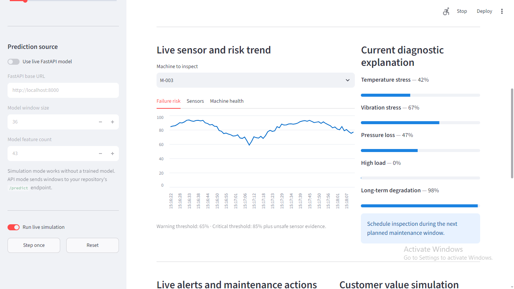
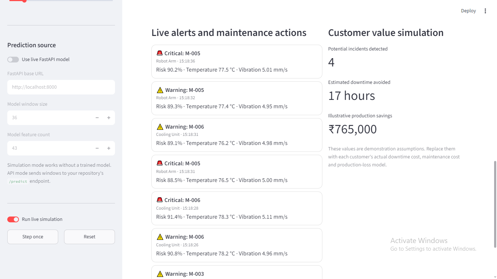

# Cross-Domain Predictive Maintenance and Health Prognostics in Industry 4.0

A production-oriented TensorFlow project that predicts equipment failure from multivariate manufacturing sensor data and demonstrates the complete journey from raw telemetry to customer-facing maintenance alerts.

The repository includes:

- Synthetic manufacturing telemetry generation
- Missing-value treatment and rolling feature engineering
- Future failure-window labeling
- Chronological train, validation and test splits
- TensorFlow CNN–BiLSTM sequence model
- Focal loss for imbalanced failure data
- Threshold tuning and model evaluation
- FastAPI model serving
- TensorFlow Serving export
- Simulated streaming predictions
- Drift and alert decision utilities
- Customer-facing Streamlit live simulation UI

---

## Project showcase

The following views demonstrate the live predictive-maintenance experience, including fleet health, machine-level risk, sensor trends, alerts and customer-facing business outcomes.

<p align="center">
  
</p>

<table>
  <tr>
    <td width="50%" align="center">
      
    </td>
    <td width="50%" align="center">
      
    </td>
  </tr>
</table>

> Place `Project-View-1.png`, `Project-View-2.png` and `Project-View-3.png` in the repository root beside `README.md`.

---

## Business problem

Unexpected machine failures can stop production, delay customer orders, increase emergency repair costs and create safety risks.

This project builds an early-warning system that continuously studies signals such as temperature, vibration, pressure, RPM and machine load. It estimates the probability that a machine may fail within a configurable future period, such as the next 24 hours.

The resulting risk score can be combined with engineering safety rules and technician review before a maintenance work order is created.

---

## End-to-end architecture

```text
Machines, PLCs and sensors
            |
            v
Telemetry ingestion or CSV data
            |
            v
Cleaning, interpolation and validation
            |
            v
Failure-horizon labels and rolling features
            |
            v
Chronological train, validation and test split
            |
            v
TensorFlow CNN–BiLSTM with focal loss
            |
            v
Threshold tuning and backtesting
            |
      +-----+-------------------+
      |                         |
      v                         v
FastAPI prediction API   TensorFlow Serving
      |                         |
      +------------+------------+
                   v
        Risk score and safety rules
                   |
                   v
     Warning, technician review or work order
                   |
                   v
Customer dashboard, drift monitoring and KPIs
```

---

## Technology stack

| Area | Technologies |
|---|---|
| Programming | Python 3.11 or Python 3.12 |
| Data processing | Pandas, NumPy |
| Feature scaling | Scikit-learn |
| Deep learning | TensorFlow and Keras |
| Model architecture | CNN and Bidirectional LSTM |
| Evaluation | Precision, recall, F1, ROC-AUC and PR-AUC |
| API | FastAPI and Uvicorn |
| Model serving | TensorFlow Serving |
| Customer UI | Streamlit |
| Monitoring | TensorBoard, PSI drift utilities and alert logs |
| Packaging | Docker and Docker Compose |
| Testing | Pytest |

> TensorFlow does not currently install correctly with Python 3.14 on native Windows. Use 64-bit Python 3.11 or Python 3.12.

---

## Repository structure

```text
AI-Driven Predictive Maintenance for Manufacturing/
|
|-- api/
|   `-- main.py                         FastAPI prediction service
|
|-- configs/
|   `-- config.json                     Data, training and alert settings
|
|-- data/
|   |-- raw/                            Generated or real sensor data
|   `-- processed/                      Model-ready arrays and metadata
|
|-- models/                             Keras and TensorFlow Serving exports
|-- monitoring/                         TensorBoard logs and monitoring output
|-- reports/                            Metrics, predictions and charts
|
|-- scripts/
|   |-- run_pipeline.py                 Complete ML pipeline
|   |-- simulate_stream.py              Command-line streaming simulation
|   `-- run_customer_demo.py            Streamlit customer demo launcher
|
|-- src/
|   |-- config.py                       Configuration loader
|   |-- generate_data.py                Synthetic plant telemetry generator
|   |-- preprocess.py                   Labels, features, scaling and windows
|   |-- model.py                        CNN–BiLSTM and focal loss
|   |-- train.py                        Training, checkpoints and export
|   |-- evaluate.py                     Threshold tuning and evaluation
|   `-- monitor.py                      PSI drift and alert decisions
|
|-- tests/                              Automated validation tests
|
|-- ui/
|   |-- dashboard.py                    Live customer-facing simulation
|   `-- README_UI.md                    UI-specific setup notes
|
|-- Predictive_Maintenance_Project.ipynb
|-- requirements.txt                    Core ML and API packages
|-- requirements-ui.txt                 Streamlit demonstration packages
|-- docker-compose.yml
|-- Dockerfile.api
|-- START_CUSTOMER_DEMO.bat             Windows customer demo launcher
|-- start_customer_demo.sh              macOS/Linux customer demo launcher
`-- README.md
```

---

## 1. Environment setup

### Windows Git Bash

Create a virtual environment explicitly with Python 3.12:

```bash
py -3.12 -m venv .venv
source .venv/Scripts/activate
```

### Windows Command Prompt or PowerShell

```powershell
py -3.12 -m venv .venv
.venv\Scripts\activate
```

### macOS or Linux

```bash
python3.12 -m venv .venv
source .venv/bin/activate
```

Verify the Python version:

```bash
python --version
```

Expected:

```text
Python 3.11.x
```

or:

```text
Python 3.12.x
```

Upgrade the installation tools:

```bash
python -m pip install --upgrade pip setuptools wheel
```

---

## 2. Install dependencies

Install the machine-learning and API packages:

```bash
python -m pip install -r requirements.txt
```

Install the customer UI packages:

```bash
python -m pip install -r requirements-ui.txt
```

TensorBoard must be available because the training script writes training metrics and graphs:

```bash
python -m pip install --upgrade tensorboard
```

Verify the main packages:

```bash
python -c "import tensorflow as tf; print('TensorFlow:', tf.__version__)"
python -c "import tensorboard; print('TensorBoard:', tensorboard.__version__)"
python -c "import streamlit; print('Streamlit:', streamlit.__version__)"
```

---

## 3. Run the complete machine-learning pipeline

```bash
python scripts/run_pipeline.py
```

This executes the following stages:

```text
Generate sensor data
        |
        v
Preprocess and engineer features
        |
        v
Create chronological time windows
        |
        v
Train the TensorFlow model
        |
        v
Evaluate and export results
```

You can also run each stage separately:

```bash
python -m src.generate_data
python -m src.preprocess
python -m src.train
python -m src.evaluate
```

### Main outputs

```text
data/raw/sensor_data.csv

data/processed/prepared.npz
data/processed/preprocessor.joblib
data/processed/test_meta.csv

models/best.keras
models/predictive_maintenance.keras
models/predictive_maintenance/1/

reports/metrics.json
reports/test_predictions.csv
reports/precision_recall_curve.png
reports/training_history.json
```

---

## 4. Start TensorBoard

TensorBoard displays training loss and model metrics by epoch.

```bash
tensorboard --logdir monitoring/tensorboard
```

Open:

```text
http://localhost:6006
```

The following measurements are recorded during training:

- Training and validation loss
- Precision
- Recall
- ROC-AUC
- PR-AUC

---

## 5. Start the FastAPI prediction service

```bash
uvicorn api.main:app --reload --port 8000
```

Open the interactive API documentation:

```text
http://localhost:8000/docs
```

Health endpoint:

```text
GET http://localhost:8000/health
```

Prediction endpoint:

```text
POST http://localhost:8000/predict
```

Example response:

```json
{
  "machine_id": "M-001",
  "failure_probability": 0.82,
  "alert": true,
  "latency_ms": 18.4,
  "model_version": "1"
}
```

---

## 6. Run the command-line streaming simulation

Start the FastAPI service first, then run this command in another terminal:

```bash
python scripts/simulate_stream.py --limit 25
```

The script sends test windows to the API one by one and prints live prediction responses.

---

# Live customer demonstration UI

The repository includes a Streamlit dashboard for visually demonstrating predictive maintenance to customers, business leaders and interviewers.

The UI works in two modes:

1. **Built-in demonstration mode** — runs without a trained TensorFlow model.
2. **Live FastAPI mode** — calls the project's `/predict` endpoint.

---

## 7. Start the customer-facing UI

### Recommended command

```bash
python scripts/run_customer_demo.py
```

You can also run Streamlit directly:

```bash
streamlit run ui/dashboard.py
```

Open:

```text
http://localhost:8501
```

### Windows one-click launcher

After installing the dependencies, double-click:

```text
START_CUSTOMER_DEMO.bat
```

### macOS or Linux

```bash
chmod +x start_customer_demo.sh
./start_customer_demo.sh
```

---

## Customer UI features

The live dashboard includes:

- Multiple simulated manufacturing machines
- Fleet health score
- Machine-level failure probability
- Temperature, vibration and pressure trends
- Machine health trend
- Normal, warning and critical states
- Live maintenance-alert feed
- Diagnostic risk-factor explanations
- Technician-review recommendation
- Automatic work-order simulation
- Estimated downtime avoided
- Illustrative production savings
- Adjustable simulation speed
- Selectable machine count
- Built-in narration guide for customer presentations

---

### Customer demonstration gallery

| Fleet overview | Diagnostics | Alerts and business value |
|---|---|---|
|  |  |  |


## Demonstration scenarios

### Normal plant operation

Shows machines running within healthy operating ranges. Use this scenario to explain continuous monitoring and establish the normal baseline.

### Gradual bearing wear

Increases vibration and degradation for a selected machine. Use it to demonstrate how the system detects a failure pattern before a breakdown.

### Cooling system failure

Raises machine temperature and risk. Use it to show how multiple signals contribute to the final failure probability.

### High-load production surge

Pushes machines toward high utilization. Use it to explain why load alone may not indicate failure, but becomes important when combined with temperature, vibration and degradation.

### Multiple-machine incident

Creates risk across several machines. Use it to demonstrate fleet-level prioritization and maintenance planning.

---

## Suggested customer presentation flow

1. Start with **Normal plant operation**.
2. Explain the fleet-health and machine-health cards.
3. Select **Gradual bearing wear**.
4. Turn on **Run live simulation**.
5. Select machine `M-002` for detailed inspection.
6. Show vibration and failure probability increasing over time.
7. Explain the change from normal to warning or critical.
8. Show the diagnostic contribution of temperature, vibration, pressure and load.
9. Explain the technician-review and work-order recommendation.
10. Close with estimated downtime avoided and production savings.

The savings values in the demonstration are illustrative. Replace them with the customer's actual values for:

- Cost per hour of production downtime
- Emergency maintenance cost
- Planned maintenance cost
- Average repair duration
- Revenue or production loss per hour

---

## Use the live FastAPI model inside the UI

Start the API in Terminal 1:

```bash
uvicorn api.main:app --reload --port 8000
```

Start the UI in Terminal 2:

```bash
python scripts/run_customer_demo.py
```

Inside the sidebar:

1. Enable **Use live FastAPI model**.
2. Use `http://localhost:8000` as the API URL.
3. Set the model window size from `configs/config.json`.
4. Set the feature count expected by the trained model.

### Important production integration note

The TensorFlow model expects scaled and engineered features generated by `src/preprocess.py`. The current UI API option creates a generic demonstration window.

For exact production scoring, introduce a raw sensor endpoint that:

```text
Receives raw machine readings
          |
          v
Loads the saved preprocessing artifacts
          |
          v
Creates rolling and difference features
          |
          v
Applies the saved scaler
          |
          v
Builds the model input window
          |
          v
Calls the TensorFlow model
```

The built-in dashboard mode is recommended for reliable customer demonstrations because it does not depend on model availability or feature-shape compatibility.

---

## 8. TensorFlow Serving

Training exports a versioned SavedModel to:

```text
models/predictive_maintenance/1
```

Start TensorFlow Serving:

```bash
docker compose up tensorflow-serving
```

Prediction endpoint:

```text
POST http://localhost:8501/v1/models/predictive_maintenance:predict
```

Start every configured service:

```bash
docker compose up --build
```

---

## 9. Real manufacturing data schema

The preprocessing pipeline expects the following raw fields:

| Column | Meaning |
|---|---|
| `timestamp` | Sensor reading time |
| `machine_id` | Unique machine identifier |
| `machine_type` | Pump, motor, compressor or another category |
| `temperature` | Machine temperature |
| `vibration` | Machine vibration level |
| `pressure` | Internal pressure |
| `rpm` | Rotational speed |
| `load` | Current operating load |
| `production_rate` | Units produced over time |
| `ambient_temp` | Temperature around the machine |
| `humidity` | Environmental humidity |
| `failure_event` | Whether a failure occurred |

Optional descriptive fields can include:

- Shift
- Factory or plant
- Production line
- Failure type
- Maintenance action
- Component replaced
- Technician notes

Replace:

```text
data/raw/sensor_data.csv
```

with synchronized real telemetry and maintenance records, then run:

```bash
python -m src.preprocess
python -m src.train
python -m src.evaluate
```

---

## 10. Model design

Each model input is a fixed historical sequence of sensor and engineered feature values.

The label asks:

> Will this machine fail within the configured future horizon?

The default configuration uses:

- Sensor frequency: every 10 minutes
- Historical window: 36 readings
- Historical duration: 6 hours
- Prediction horizon: next 24 hours

The model combines:

### Convolutional layers

The CNN detects short local warning patterns such as vibration spikes, rapid heating and simultaneous pressure loss.

### Bidirectional LSTM

The LSTM learns longer time relationships and gradual degradation patterns across the sequence.

### Focal loss

Failure events are much rarer than healthy readings. Focal loss reduces the influence of easy healthy examples and places more attention on difficult or rare failure examples.

---

## 11. Validation design

The split is chronological rather than random:

```text
Older data       Later data        Newest data
Training    ->   Validation   ->   Testing
```

This prevents future information from leaking into training.

The alert threshold is selected using validation data and then frozen before final test evaluation.

### Model-quality metrics

- Precision
- Recall
- F1 score
- ROC-AUC
- PR-AUC
- Confusion matrix

### Operational metrics

- Prediction latency
- Throughput
- Scoring coverage
- API availability
- Alert volume
- Data drift
- Sensor health

### Business metrics

- Unexpected downtime
- Mean time between failures
- Emergency maintenance cost
- Planned maintenance cost
- Avoided production loss
- False-alarm inspection cost
- Failure detection lead time

---

## 12. Monitoring and drift

The repository includes a Population Stability Index utility for comparing reference and current feature distributions.

Drift can happen because of:

- New machinery
- Sensor replacement or recalibration
- Seasonal temperature changes
- Raw material changes
- Different operating loads
- Equipment aging
- Maintenance-policy changes

A production monitoring process should track:

```text
Input data quality
        |
        v
Feature distribution drift
        |
        v
Prediction distribution drift
        |
        v
Precision and recall after outcomes arrive
        |
        v
Business impact and maintenance feedback
```

---

## 13. Production safety controls

Recommended controls include:

- Human confirmation before costly maintenance actions
- Engineering rules combined with model probability
- Shadow-mode testing before active alerts
- Machine-specific and machine-type-specific evaluation
- Model versioning and rollback
- Audit records for predictions and technician decisions
- Canary deployment before fleet-wide rollout
- Minimum data-quality checks before scoring
- Alert deduplication and cooldown periods
- Feedback capture after inspection or repair

---

## 14. Run automated tests

```bash
pytest -q
```

The tests cover core preprocessing and monitoring behaviour.

---

## 15. Common troubleshooting

### TensorFlow cannot be installed

Error:

```text
No matching distribution found for tensorflow
```

Cause: the environment is likely using Python 3.14.

Fix:

```bash
deactivate
rm -rf .venv
py -3.12 -m venv .venv
source .venv/Scripts/activate
python -m pip install --upgrade pip setuptools wheel
python -m pip install -r requirements.txt
```

### TensorBoard is not installed

Error:

```text
tensorflow.python.summary.tb_summary.TBNotInstalledError
```

Fix:

```bash
python -m pip install --upgrade tensorboard
python -m src.train
```

### TensorFlow reports that native Windows GPU support is unavailable

This is an informational warning. TensorFlow 2.11 and newer will train on the CPU in native Windows.

For NVIDIA GPU acceleration, use WSL2 with a supported TensorFlow and CUDA configuration.

### The Streamlit page does not open automatically

Open the URL manually:

```text
http://localhost:8501
```

### Port 8501 is already in use

```bash
streamlit run ui/dashboard.py --server.port 8502
```

Then open:

```text
http://localhost:8502
```

### The UI cannot reach FastAPI

Confirm that the API is running:

```text
http://localhost:8000/health
```

Then verify that the sidebar API URL is:

```text
http://localhost:8000
```

---

## 16. Interview explanation

> This project predicts manufacturing equipment failures using multivariate sensor data such as temperature, vibration, pressure, RPM and load. The pipeline cleans the telemetry, creates rolling and trend features, and labels each historical window according to whether a failure will occur within the next 24 hours. A TensorFlow CNN–BiLSTM model learns short sensor anomalies as well as longer degradation patterns. Focal loss helps with the imbalance between common healthy readings and rare failure examples. The model is validated on later time periods, and its alert threshold is selected using validation data. The trained model can be served through FastAPI or TensorFlow Serving. A Streamlit dashboard provides a live customer demonstration with sensor trends, failure probabilities, diagnostic factors, alerts, maintenance actions and illustrative business savings. In production, model risk is combined with engineering safety rules and technician confirmation before maintenance work orders are opened.

---

## 17. Project outcome

The goal is not only to predict a failure. The goal is to provide enough warning for a factory to take action before a breakdown occurs.

```text
Early warning
    -> Planned inspection
    -> Timely maintenance
    -> Less unexpected downtime
    -> Lower repair cost
    -> Safer and more reliable production
```
